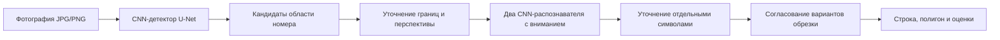
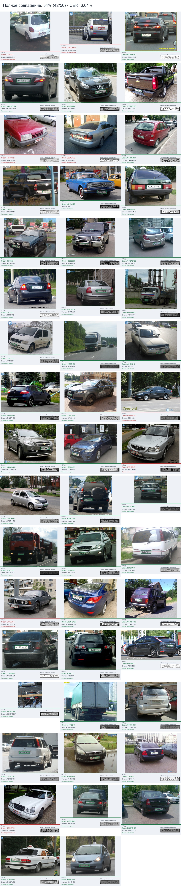

# Отчёт о разработке и тестировании системы распознавания автомобильных номеров

## 1. Основные результаты

Разработана система, которая самостоятельно находит и читает один российский
автомобильный номер на фотографии JPG/PNG. Для получения ответа не нужны
JSON-разметка, координаты номера или эталонный текст. Система возвращает
распознанную строку, четырёхугольник области номера и служебные оценки.

Используются собственные обученные нейронные сети: небольшой CNN-детектор
U-Net, два CNN-распознавателя с механизмом внимания и два классификатора
отдельных символов. Сторонние предобученные модели и готовые OCR-сервисы
не использовались. PyTorch, NumPy, Pillow и OpenCV применяются как инструменты
вычислений и обработки изображений, что соответствует уточнённому ограничению
на использование библиотек.

| Проверка | Результат | Как интерпретировать |
|---|---:|---|
| Новый внешний отложенный набор, 50 фотографий | **42/50 — 84%** | Основной итог проверки обобщения v5 |
| CER на этих 50 фотографиях | **25/414 — 6,04%** | 25 операций редактирования на 414 эталонных символов |
| Предыдущая v4 на тех же 50 фотографиях | 24/50 — 48% | Сравнение версий на одинаковых входах |
| Локальный `data/test/colored` | 10/10 — 100% | Ранее многократно исследованный набор |
| Локальный `data/test/gray_scaled` | 10/10 — 100% | Серые версии тех же десяти тестовых изображений |
| Автоматические тесты после рефакторинга | 29 пройдено | Проверка программной реализации и регрессии |

**Цель 90% на независимых данных не достигнута.** Упаковка репозитория
не изменила предсказания: все 50 строк совпали с исходным протоколом v5.
При подготовке этого отчёта новые веса не обучались и новая независимая
выборка не оценивалась; сведения сведены из сохранённых протоколов и кода.

## 2. Постановка задачи и изменение требований

Изначально требовалось определить направление обхода точек JSON-полигона:
по часовой стрелке или против неё. В исходных разметках использовался обход
против часовой стрелки. Такой признак зависит от последовательности точек
в JSON: по одной фотографии восстановить выбранный аннотатором порядок
записи точек невозможно.

Дальнейшие требования были уточнены: система должна получать изображение
без аннотации, самостоятельно находить номер и распознавать его символы.
Именно эта задача реализована в итоговой v5. Эксперимент с направлением
обхода удалён вместе с неиспользуемым кодом и в текущий интерфейс не входит.

Целевая область применения — стандартный однострочный российский номер
с одним основным объектом на фотографии. Строка имеет формат
«буква, три цифры, две буквы, две или три цифры региона».
Используется латинское представление похожих русских букв:
`0123456789ABCEHKMOPTXY` — 22 символа.

## 3. Данные

### 3.1. Исходный пользовательский набор

| Раздел | Исходных сцен | Файлов изображений | JSON-аннотаций | Назначение |
|---|---:|---:|---:|---|
| `data/train` | 90 | 180: цветные и серые варианты | 90 | Обучение и исходные эксперименты |
| `data/valid` | 10 | 20: цветные и серые варианты | 10 | Локальная проверка |
| `data/test` | 10 | 20: цветные и серые варианты | 0 | Распознавание без разметки на входе |

Аннотации имеют формат LabelMe: полигон `number` с четырьмя точками.
Эталоны текста локального теста берутся из имён файлов только при подсчёте
метрик. Распознаватель получает пиксели; имя файла и эталон в модель
не передаются. Цветная и серая версии не являются независимыми сценами.

### 3.2. Расширение обучающего набора

Для улучшения переносимости использованы внешние реальные данные:

| Компонент | Train | Validation | Вид разметки |
|---|---:|---:|---|
| Детектор | 1200 внешних + 90 исходных сцен | 120 внешних сцен | Внешние прямоугольники и исходные полигоны |
| Основной OCR | 9999 фрагментов номеров | 600 фрагментов | Эталонные строки |

Внешние источники закреплены по конкретным revisions:

| Источник | Revision |
|---|---|
| [AY000554/Car_plate_detecting_dataset](https://huggingface.co/datasets/AY000554/Car_plate_detecting_dataset) | `f1a57c262cad86e3541bc0a3d951fc021527743c` |
| [adasdaadadad/Car_plate_OCR_dataset](https://huggingface.co/datasets/adasdaadadad/Car_plate_OCR_dataset) | `d620cadf26ec824194c3aeeb7a94bef42101d8e0` |

Карточки источников и поставленные с ними тексты лицензий сохранены
в [data/sources](data/sources). В этих текстах указаны AUTO.RIA,
ARS Online OU и Creative Commons Attribution 4.0.
Состав выборок, пути элементов архивов, метки и SHA-256 находятся
в [обучающем manifest](data/manifests/training.json).

### 3.3. Контрольные внешние наборы

Первый внешний тест включал 30 полных фотографий и 100 готовых
OCR-фрагментов. После анализа ошибок этот набор стал **development**:
по нему сравнивались варианты алгоритма. Его последующие результаты
нельзя считать новой независимой оценкой.

Для итоговой проверки v5 до обучения был выделен другой набор:

1. Зафиксирован перемешанный список из 65 кандидатов внешнего test-раздела.
2. Взяты первые 50 читаемых стандартных номеров с одним целевым объектом.
3. Один многономерный кадр и два с ненадёжно читаемым текстом исключены;
   оставшиеся 12 сверх квоты не использовались.
4. Строки транскрибированы одним аннотатором до обучения v5.
5. До первого запуска на этих 50 изображениях зафиксированы веса,
   конфигурация, код и контрольные суммы.

Manifest и изображения сохранены в [data/external/holdout](data/external/holdout).
Протокол отбора: [holdout_protocol.json](reports/provenance/holdout_protocol.json).

## 4. Архитектура и принципы работы



### 4.1. Детектор номера

Детектор предсказывает логит принадлежности каждого пикселя области номера.
После sigmoid получается карта вероятностей. Это компактная U-Net
с **13 свёрточными слоями и 120 473 обучаемыми параметрами**.

Каждый блок `Block(a, b)` содержит две последовательности
`Conv2d(3×3, padding=1) → BatchNorm2d → ReLU`.

Ниже размеры приведены как **каналы × высота × ширина**, без batch.
Рабочий размер детекции — 512×384 пикселя по ширине и высоте.

| Этап | Операции | Размер выхода |
|---|---|---|
| Вход | RGB-тензор | 3×384×512 |
| Предварительное уменьшение | Average Pooling 2×2 | 3×192×256 |
| Encoder A | Две свёртки, 3 → 8 каналов | 8×192×256 |
| Encoder B | Max Pooling 2×2, две свёртки 8 → 16 | 16×96×128 |
| Encoder C | Max Pooling 2×2, две свёртки 16 → 32 | 32×48×64 |
| Encoder D | Max Pooling 2×2, две свёртки 32 → 64 | 64×24×32 |
| Decoder C | Bilinear upsampling, объединение с C, две свёртки 96 → 32 | 32×48×64 |
| Decoder B | Bilinear upsampling, объединение с B, две свёртки 48 → 16 | 16×96×128 |
| Выход | Свёртка 1×1, увеличение до размера входа | 1×384×512 |

Свёртки учатся выделять границы и структуры номера. Batch Normalization
стабилизирует распределения признаков, ReLU добавляет нелинейность.
Pooling уменьшает вычисления и расширяет область контекста.
Связи encoder–decoder возвращают пространственную информацию,
необходимую для локализации.

Обучающий размер детектора — 384×288; размер рабочего инференса 512×384
закреплён в [pipeline.json](models/v5/pipeline.json).
По карте вероятностей строятся геометрические кандидаты,
переводимые в координаты исходной фотографии.

### 4.2. Распознавание полной строки

Две модели A и B имеют одинаковую архитектуру, но разные обученные веса
и режимы геометрической аугментации. Каждая содержит **4 свёрточных слоя,
2 слоя Transformer Decoder и 513 703 параметра**.

| Этап | Операции | Размер выхода |
|---|---|---|
| Вход | Серый фрагмент номера 160×32 | 1×32×160 |
| CNN 1 | Conv 1 → 24, 3×3; BatchNorm; SiLU; Max Pooling 2×2 | 24×16×80 |
| CNN 2 | Conv 24 → 48, 3×3; BatchNorm; SiLU; Max Pooling 2×2 | 48×8×40 |
| CNN 3 | Conv 48 → 64, 3×3; BatchNorm; SiLU; Max Pooling 2×1 | 64×4×40 |
| CNN 4 | Conv 64 → 96, 3×3; BatchNorm; SiLU; Adaptive Average Pooling | 96×1×40 |
| Проекция | Linear 96 → 128 и обучаемые позиции | 40×128 |
| Внимание | 9 обучаемых запросов, 2 слоя Decoder | 9×128 |
| Классификация | LayerNorm и Linear 128 → 23 | 9×23 |

SiLU вычисляется как `x × sigmoid(x)` и даёт гладкую нелинейность.
Сорок пространственных позиций описывают изображение по горизонтали.
Девять запросов соответствуют позициям выходной строки. В каждом слое
внимания используются 4 головы, размер признаков 128, feed-forward 256
и dropout 0,1 при обучении.

Выход содержит 22 символа алфавита и класс padding. Последний нужен
для номера с двухзначным регионом. Маска формата разрешает буквы
в позициях 1, 5, 6 и цифры в остальных позициях; padding допускается
в девятой позиции. Это ограничивает недопустимые строки, но не гарантирует
правильность синтаксически допустимого ответа.

Вероятности A и B усредняются с одинаковыми весами. Перед softmax логиты
делятся на температуру **1,3** для обеих моделей.

### 4.3. Классификаторы отдельных символов

Для дополнительного уточнения используются две глифовые CNN,
каждая с **3 свёрточными, 2 полносвязными слоями и 384 662 параметрами**:

```text
Вход 1×32×28
→ Conv 1→24, 3×3 → ReLU → Max Pooling 2×2
→ Conv 24→48, 3×3 → ReLU → Max Pooling 2×2
→ Conv 48→64, 3×3 → ReLU
→ Flatten 3584 → Linear 3584→96 → ReLU → Linear 96→22
```

Глифовое уточнение применяется только при согласованной полной сегментации:
число компонент должно совпадать с длиной строки, проверяются границы,
пропорции, выравнивание и уверенность символов. Вес уточнения — **0,25**.
Оценки визуально похожих `O` и `0` объединяются перед учётом допустимой позиции.
При ненадёжной сегментации остаётся ответ основного распознавателя.

### 4.4. Геометрия и согласование ответов

Конвейер сравнивает несколько границ и отступов при вырезании номера,
выполняет перспективное преобразование и учитывает совпадение строк
между вариантами. Фрагменты обрабатываются пакетами.

При слабом чтении предусмотрены повторная детекция в локальной области
и поиск по перекрывающимся частям фотографии. В выбранной конфигурации
`tile_recovery=true`, порог `recovery_log_score=-0.3`.

Весь комплект содержит **1 917 203 параметра**:
`120 473 + 2 × 513 703 + 2 × 384 662`.
Реализация архитектур: [networks.py](src/number_search/networks.py).

## 5. Обучение

Поддерживаемый контур обучения использует AdamW, weight decay `0.0001`
и косинусное снижение learning rate. Для детектора применяется сумма
взвешенной бинарной кросс-энтропии с `pos_weight=15` и Dice Loss.
Для OCR и отдельных символов используется Cross Entropy.
При обучении OCR норма градиента ограничивается значением 5.

В аугментации включены изменения яркости и контраста, шум, размытие,
масштабирование, небольшие повороты, сдвиги и наклон.
У модели B геометрическая аугментация усилена.

Выбирается лучший checkpoint по validation, а не автоматически последняя эпоха.

| Компонент | Выполнено эпох | Выбранная эпоха | Метрика выбранного checkpoint |
|---|---:|---:|---|
| Детектор | 35 | 32 | Validation mask IoU 0,77952 |
| OCR A | 25 | 13 | 572/600 — 95,33%; CER 1,27% |
| OCR B | 4 прогрева + 15 дообучения | 9-я эпоха дообучения | 580/600 — 96,67%; CER 1,03% |

Метрики OCR в таблице измерены на готовых фрагментах: они не включают
ошибки поиска номера на полной фотографии. Mask IoU детектора также
не является точностью распознавания строки.

Глифовые CNN перенесены из собственных предыдущих экспериментов.
Часть v5 обучалась или дообучалась с использованием собственных ранних
и промежуточных весов. Текущие команды обучения поддерживают дальнейшую
работу, но не обещают побитового воспроизведения v5 после удаления
промежуточных checkpoint.

Истории: [детектор](reports/training/detector.json),
[OCR A](reports/training/attention_a.json),
[прогрев B](reports/training/attention_b_warmup.json),
[OCR B](reports/training/attention_b.json).
Инструкции: [docs/training.md](docs/training.md).

## 6. Развитие решения и устранение ошибок

1. **Начальная CNN+GRU+CTC.** На исходном тесте не было полностью правильных
   строк. Проверка показала, что приемлемая сегментация области сама по себе
   не обеспечивает корректного OCR.
2. **Классификация отдельных символов и формат номера.** Исторический
   результат вырос до 60% на серых и 70% на цветных изображениях.
3. **Ансамбль, обработка рамки, уточнение границ и O/0.** Исторический
   результат достиг 90% на обоих локальных вариантах.
4. **Согласование обрезок, пакетная обработка и повторный поиск.** На известных
   десяти номерах получено 100%. Из-за многократного анализа это результат
   разработки, а не доказательство переносимости.
5. **Первый внешний тест.** Получено 14/30 на полных сценах и 69/100
   на готовых OCR-фрагментах. Выявлен разрыв между локальным тестом
   и внешними изображениями.
6. **Переход к v5.** Расширены данные детекции и OCR, добавлены распознаватели
   с вниманием, более сильная геометрия и консервативное глифовое уточнение.

Промежуточные локальные проценты приведены по сохранённому
[описанию исследования](docs/research.md). Старые реализации и часть
производных данных удалены при очистке; основными проверяемыми итогами
служат сохранённые JSON-протоколы v4/v5 и текущие веса.

## 7. Методика оценки

Основная метрика — полное совпадение строки, включая регион:

```text
Exact Accuracy = число полностью правильных строк / число изображений
CER = сумма расстояний Левенштейна / сумма длин эталонных строк
Mask IoU = площадь пересечения масок / площадь объединения масок
```

Для Accuracy рассчитан 95%-й интервал Уилсона.
Подсчёт CER учитывает вставки, удаления и замены символов.
Одна ошибка региона делает всю строку неправильной по Exact Accuracy.

JSON-метки в manifest и имена файлов локального теста используются
оценщиком после предсказания. Проверка переименованием изображения
подтверждает независимость ответа от имени файла.

Проверки разделения данных зафиксировали:

- ноль точных пересечений проверяемых сцен по SHA-256;
- ноль пересечений проверяемых OCR-текстов;
- отсутствие флагов близких сцен при диагностике 256-битным difference hash
  с порогом расстояния 20.

Диагностика близких сцен выполнена **после** оценки и не меняла состав
набора или итоговую точность. Хеш-проверки снижают риск утечки, но не
доказывают отсутствие любых семантически похожих сцен.
Источник обучения и внешнего теста общий, поэтому переносимость
на другой домен отдельно не доказана.

Основания: [аудит разбиения](reports/provenance/split_audit.json),
[выбор модели](reports/provenance/selection.json),
[фиксация перед тестом](reports/provenance/final_freeze.json).

## 8. Результаты тестирования

### 8.1. Локальные данные

| Набор | Правильно | Accuracy | CER |
|---|---:|---:|---:|
| `data/valid/gray_scaled` | 9/10 | 90% | 3,61% |
| `data/test/gray_scaled` | 10/10 | 100% | 0% |
| `data/test/colored` | 10/10 | 100% | 0% |

Единственная ошибка указанной локальной validation:
`K750MT177 → O760OT177`. Источник значений — сохранённый
[контрольный runtime-протокол v5](reports/history/v5_runtime.json).
Это исторический замер, выполненный до переноса кода в пакет.

### 8.2. Первый внешний тест и последующий development

| Этап | Полные сцены | Готовые OCR-фрагменты |
|---|---:|---:|
| Первый внешний тест ранней версии | 14/30 — 46,67% | 69/100 — 69% |
| Выбранная v5 на том же наборе после разработки | 28/30 — 93,33% | 95/100 — 95% |

У первого теста CER полных сцен составлял 41,60%, OCR-фрагментов — 13,50%.
На development у выбранной v5 — 0,80% и 1,19% соответственно.
Значения 93,33% и 95% получены на данных, использованных для выбора
алгоритма, и не подменяют итог независимой проверки.

Источники: [первый внешний тест](reports/history/first_external_results.json)
и [отбор варианта v5](reports/provenance/selection.json).

### 8.3. Итоговый внешний holdout

Первый прогон замороженной v5 на новом holdout выполнен
17.11.2026, 12:32–12:33 UTC. На тех же изображениях проверена
неизменённая предыдущая v4.

| Метрика | v4 | v5 |
|---|---:|---:|
| Изображений | 50 | 50 |
| Полностью правильных строк | 24 | **42** |
| Ошибочных строк | 26 | **8** |
| Exact Accuracy | 48% | **84%** |
| CER | 37,92% | **6,04%** |

Прирост v5 — **18 правильных строк, или 36 процентных пунктов**.
Из 24 правильных ответов v4 все остались правильными в v5;
18 ошибок исправлены, 8 остались неправильными у обеих версий.
У v5 нет пустых ответов. Наличие предложенной области на всех 50 кадрах
не означает 100%-ю точность локализации: геометрическая точность на этом
holdout отдельно не измерялась.

95%-й интервал Уилсона для 42/50 — **71,49–91,66%**.
Ширина интервала связана с небольшим размером выборки.
Верхняя граница выше 90% не означает достижения целевой точности.

На наборе из 50 изображений порогу 90% соответствовали бы 45 правильных
строк. Для следующего подтверждения качества нужен новый ранее
не исследованный тест, а не настройка под уже известные восемь ошибок.

Протоколы: [исходный v5](reports/holdout/original_results.json),
[текущий пакет](reports/holdout/results.json),
[v4](reports/history/v4_reference.json),
[сравнение версий](reports/holdout/comparison.json).

## 9. Оставшиеся ошибки v5

| ID | Эталон | Ответ | Расстояние Левенштейна | Наблюдаемое расхождение |
|---:|---|---|---:|---|
| 1 | `X576AE123` | `E722AE11` | 6 | Несколько замен и различие длины |
| 2 | `C319ET199` | `C319ET197` | 1 | Последняя цифра региона: 9 → 7 |
| 7 | `K747BH16` | `T201OH21` | 7 | Большая часть строки распознана неверно |
| 8 | `B657OK70` | `B557OK70` | 1 | Первая цифра основного блока: 6 → 5 |
| 25 | `C940CC36` | `C900CC36` | 1 | Цифра основного блока: 4 → 0 |
| 28 | `X718TO199` | `X771TT16` | 5 | Несколько замен и различие длины |
| 36 | `E530HB78` | `E300AB78` | 3 | Несколько замен в основном блоке |
| 49 | `C222EY26` | `C222EY22` | 1 | Последняя цифра региона: 6 → 2 |

Четыре ошибки отличаются от эталона на один символ, ещё четыре содержат
несколько расхождений. Последние дают 21 из 25 операций редактирования.
Это указывает на необходимость разбирать тяжёлые случаи отдельно
от единичных путаниц цифр.

Неверные строки остаются допустимыми по формату. Поэтому ограничения
алфавита и длины не устраняют все ошибки. У некоторых неправильных ответов
внутренняя оценка чтения относительно высокая: например, у ID 2
`recognition_score ≈ -0.115`. Эти scores не являются калиброванными
вероятностями правильности всей строки.

В исследовании отмечались возможные проблемы перспективы, выбранной
области, обрезки рамки и различения похожих символов. Текстовая таблица
сама по себе не доказывает причину каждой ошибки. Для строгого разделения
ошибок детекции и OCR нужны контрольные углы и сравнение чтения
автоматических и эталонных фрагментов.

После первого теста эти восемь случаев не использовались для изменения
весов или правил v5. Изображения с ответами доступны в
[HTML-галерее](reports/holdout/visualizations/index.html).

## 10. Скорость работы

Сохранённый замер выполнен на CPU, Python 3.14.7, PyTorch 2.15.0+cpu,
OpenCV 5.0.0, с четырьмя потоками PyTorch.
CPU идентифицирован как `Intel64 Family 6 Model 183 Stepping 1, GenuineIntel`.

| Набор | Среднее, мс | Медиана, мс | P95, мс |
|---|---:|---:|---:|
| `valid/gray_scaled` | 72,30 | 54,37 | 161,05 |
| `test/gray_scaled` | 66,51 | 59,37 | 98,78 |
| `test/colored` | 79,19 | 71,89 | 126,08 |

Измерялось только распознавание после загрузки и прогрева:
без чтения файла, загрузки весов и построения визуализации.
В каждом разделе было десять изображений и по одному измерению на кадр.
Это небольшой исторический контрольный замер, а не нагрузочный тест
текущего пакета или гарантия задержки в эксплуатации.

Источник: [v5_runtime.json](reports/history/v5_runtime.json).

## 11. Визуализация

Для каждого результата могут сохраняться:

- фотография с предсказанным контуром, прочитанным текстом и, при оценке,
  эталоном и признаком правильности;
- выбранный системой фрагмент номера;
- HTML-галерея `index.html`;
- сводное изображение `summary.jpg`;
- JSON с координатами, строками и оценками.

Готовая галерея всех 50 контрольных фотографий:
[открыть HTML](reports/holdout/visualizations/index.html).



Зелёная рамка означает полное совпадение, красная — ошибку.
Контур предсказан моделью; эталон отображается только после распознавания.
Для оценки исходного `data/test` визуализация включается тем же CLI-флагом
`--visualize-dir`, пример приведён ниже.

## 12. Подготовка репозитория к эксплуатации

Рабочий код оформлен в устанавливаемый пакет с единой точкой входа.

```text
src/number_search/       Архитектуры, инференс, CLI, метрики и визуализация
src/number_search/training/  Офлайн-обучение и восстановление данных
models/v5/              Пять выбранных checkpoint, конфигурация и SHA-256
tests/                  Автоматические проверки
data/train,valid,test/  Исходные пользовательские данные
data/external/holdout/  50 контрольных изображений и manifest
data/manifests/         Состав расширенных обучающих данных
data/sources/           Источники и лицензии
reports/                Метрики, истории и происхождение экспериментов
docs/                   Инструкции и карточка модели
tools/                  Упаковка нового комплекта весов
```

Добавлены `pyproject.toml`, фиксация runtime-зависимостей,
сборки wheel/sdist, Dockerfile с пользователем без root и CI-конфигурация
для Python 3.12/3.14. Проверяются входные форматы, конфигурация,
контрольные суммы моделей и совместимость state dict.
Веса загружаются с `weights_only=True`, JSON записывается атомарно.
CLI возвращает JSON в stdout и диагностику ошибок в stderr.

Удалены отвергнутые архитектуры, старые точки входа, разовые скрипты,
дубликаты и промежуточные веса, скачанные архивы и обучающие кеши.
Прежний каталог `artifacts` занимал около **1,8 ГиБ**.
Исходные пользовательские фотографии, аннотации, выбранные веса,
истории и результаты сохранены. Удалённые внешние обучающие изображения
можно восстановить по manifest командой `prepare-data`.

Исторические протоколы содержат прежние пути `artifacts/...`;
они оставлены как сведения о происхождении эксперимента.
Актуальные пути и команды находятся в README и docs.

Подробности: [отчёт об очистке](reports/maintenance.md).

## 13. Проверки программной реализации

При завершении упаковки локально прошли **29 тестов**,
включая проверки на реальных весах и 50 контрольных изображениях.

| Область | Что проверялось |
|---|---|
| Входные данные | Форматы, размеры, RGB-массивы и ошибочные изображения |
| Конфигурация и модели | Недопустимые настройки, целостность и загрузка комплектов |
| Архитектура | Формы тензоров, маска алфавита, градиенты и вероятностный ансамбль |
| Постобработка | Геометрия, согласование обрезок, условный повторный поиск, глифовое уточнение |
| Оценка | Изоляция эталонов от модели, хеши изображений и пути manifest |
| CLI | Справка, код ошибки 2, диагностика без лишнего traceback |
| Обучение и данные | Минимальный обучающий прогон трёх стадий, восстановление данных и CRC |
| Визуализация | Сохранение результатов, отсутствие коллизий одинаковых имён |
| Регрессия | Совпадение всех 50 текстов с исходным v5, сохранение 42/50 и CER |
| Независимость от имени | Одинаковый результат исходного и переименованного файла |

Дополнительно успешно выполнены Ruff check/format, `pip check`,
сборки wheel/sdist, установка wheel во временный каталог
с распознаванием вне репозитория и проверка утилиты упаковки весов.

**Ограничения проверки поставки:** Docker в локальной среде недоступен,
образ не собирался. Удалённый GitHub Actions не запускался.
Наличие этих файлов не означает проведённого развёртывания.

Основание: [maintenance.md](reports/maintenance.md),
код проверок в [tests](tests).

## 14. Воспроизведение запуска и оценки

Требуется Python 3.12+. Ниже команды для Windows PowerShell из корня
репозитория; на Linux/macOS путь к интерпретатору — `.venv/bin/python`.

### Установка и проверка весов

```powershell
python -m venv .venv
.venv/Scripts/python.exe -m pip install -c requirements.lock -e .
.venv/Scripts/python.exe -m number_search verify-models
```

### Распознавание фотографии без разметки

```powershell
.venv/Scripts/python.exe -m number_search predict --image data/test/colored/a350aa150.jpg --output outputs/prediction.json --visualize-dir outputs/prediction
```

### Оценка локальных цветных и серых изображений

```powershell
.venv/Scripts/python.exe -m number_search evaluate --split data/test/colored --report outputs/test-colored.json --visualize-dir outputs/test-colored
.venv/Scripts/python.exe -m number_search evaluate --split data/test/gray_scaled --report outputs/test-gray.json --visualize-dir outputs/test-gray
```

### Регрессионная проверка внешнего набора

```powershell
.venv/Scripts/python.exe -m number_search evaluate --manifest data/external/holdout/manifest.json --report outputs/holdout.json --visualize-dir outputs/holdout
```

Повторная оценка этих известных 50 изображений проверяет сохранение
поведения и не образует новый независимый тест.

### Проверки разработки

```powershell
.venv/Scripts/python.exe -m pip install -c requirements.lock -e ".[dev]"
.venv/Scripts/python.exe -m pytest --run-integration
.venv/Scripts/python.exe -m ruff check src tests tools
.venv/Scripts/python.exe -m ruff format --check src tests tools
.venv/Scripts/python.exe -m build
```

## 15. Ограничения и дальнейшая работа

Текущий результат ограничен небольшим набором из 50 отобранных читаемых
одиночных номеров. Разметку выполнял один аннотатор без независимого
повторного подтверждения. Несколько номеров в кадре, многострочные
таблички, другие алфавиты и иной домен съёмки отдельно не проверены.
EXIF-поворот автоматически не применяется: сохранена ориентация пикселей,
использовавшаяся при обучении и тестировании.

Для следующего этапа предложены, но ещё не реализованы:

1. Более точная оценка углов и исправление перспективы номера.
2. Обучение OCR на фрагментах, полученных реальным детектором,
   включая смещения, часть рамки и фона.
3. Расширение сложных примеров похожих цифр и букв без настройки
   под конкретные строки текущего holdout.
4. Калибровка уверенности и проверка режима отказа от ненадёжного ответа.
5. Новый заранее отложенный внешний тест, больше изображений,
   независимое подтверждение эталонов и проверка на другом источнике.

Разработанный конвейер работает без входной разметки и воспроизводимо
сохраняет ответы выбранной v5. Подтверждённый результат на исходно
отложенном внешнем тесте — **84% полного совпадения**, при этом
требование **90% остаётся невыполненным**.

## Приложение А. Все предсказания на внешнем holdout

Таблица соответствует [текущему JSON-протоколу](reports/holdout/results.json).
Пропуски в ID связаны с зафиксированным отбором до тестирования.

| ID | Эталон | Предсказание v5 | Результат | Расстояние Левенштейна |
|---:|---|---|---|---:|
| [1](reports/holdout/visualizations/1_6b86b273ff34__001.jpg.result.jpg) | `X576AE123` | `E722AE11` | Ошибка | 6 |
| [2](reports/holdout/visualizations/2_d4735e3a265e__002.jpg.result.jpg) | `C319ET199` | `C319ET197` | Ошибка | 1 |
| [3](reports/holdout/visualizations/3_4e07408562be__003.jpg.result.jpg) | `C840BE197` | `C840BE197` | Верно | 0 |
| [4](reports/holdout/visualizations/4_4b227777d4dd__004.jpg.result.jpg) | `M411HO174` | `M411HO174` | Верно | 0 |
| [5](reports/holdout/visualizations/5_ef2d127de37b__005.jpg.result.jpg) | `M569MM64` | `M569MM64` | Верно | 0 |
| [6](reports/holdout/visualizations/6_e7f6c011776e__006.jpg.result.jpg) | `X777AT190` | `X777AT190` | Верно | 0 |
| [7](reports/holdout/visualizations/7_7902699be42c__007.jpg.result.jpg) | `K747BH16` | `T201OH21` | Ошибка | 7 |
| [8](reports/holdout/visualizations/8_2c624232cdd2__008.jpg.result.jpg) | `B657OK70` | `B557OK70` | Ошибка | 1 |
| [10](reports/holdout/visualizations/10_4a44dc153642__010.jpg.result.jpg) | `C445OM69` | `C445OM69` | Верно | 0 |
| [11](reports/holdout/visualizations/11_4fc82b26aecb__011.jpg.result.jpg) | `K639BK29` | `K639BK29` | Верно | 0 |
| [12](reports/holdout/visualizations/12_6b51d431df5d__012.jpg.result.jpg) | `M041YX72` | `M041YX72` | Верно | 0 |
| [13](reports/holdout/visualizations/13_3fdba35f04dc__013.jpg.result.jpg) | `B666YM102` | `B666YM102` | Верно | 0 |
| [14](reports/holdout/visualizations/14_8527a891e224__014.jpg.result.jpg) | `K281EE40` | `K281EE40` | Верно | 0 |
| [15](reports/holdout/visualizations/15_e629fa6598d7__015.jpg.result.jpg) | `H998EC77` | `H998EC77` | Верно | 0 |
| [16](reports/holdout/visualizations/16_b17ef6d19c7a__016.jpg.result.jpg) | `T412AB123` | `T412AB123` | Верно | 0 |
| [17](reports/holdout/visualizations/17_4523540f1504__017.jpg.result.jpg) | `K511AK21` | `K511AK21` | Верно | 0 |
| [18](reports/holdout/visualizations/18_4ec9599fc203__018.jpg.result.jpg) | `H090MX29` | `H090MX29` | Верно | 0 |
| [19](reports/holdout/visualizations/19_9400f1b21cb5__019.jpg.result.jpg) | `K609HO63` | `K609HO63` | Верно | 0 |
| [20](reports/holdout/visualizations/20_f5ca38f748a1__020.jpg.result.jpg) | `T444XX35` | `T444XX35` | Верно | 0 |
| [21](reports/holdout/visualizations/21_6f4b6612125f__021.jpg.result.jpg) | `H199TK61` | `H199TK61` | Верно | 0 |
| [22](reports/holdout/visualizations/22_785f3ec7eb32__022.jpg.result.jpg) | `A010XC13` | `A010XC13` | Верно | 0 |
| [23](reports/holdout/visualizations/23_535fa30d7e25__023.jpg.result.jpg) | `M123AX32` | `M123AX32` | Верно | 0 |
| [24](reports/holdout/visualizations/24_c2356069e9d1__024.jpg.result.jpg) | `O755OO99` | `O755OO99` | Верно | 0 |
| [25](reports/holdout/visualizations/25_b7a56873cd77__025.jpg.result.jpg) | `C940CC36` | `C900CC36` | Ошибка | 1 |
| [26](reports/holdout/visualizations/26_5f9c4ab08cac__026.jpg.result.jpg) | `M430HY102` | `M430HY102` | Верно | 0 |
| [27](reports/holdout/visualizations/27_670671cd9740__027.jpg.result.jpg) | `K736AX32` | `K736AX32` | Верно | 0 |
| [28](reports/holdout/visualizations/28_59e19706d51d__028.jpg.result.jpg) | `X718TO199` | `X771TT16` | Ошибка | 5 |
| [29](reports/holdout/visualizations/29_35135aaa6cc2__029.jpg.result.jpg) | `O787HH70` | `O787HH70` | Верно | 0 |
| [30](reports/holdout/visualizations/30_624b60c58c9d__030.jpg.result.jpg) | `T002EP197` | `T002EP197` | Верно | 0 |
| [31](reports/holdout/visualizations/31_eb1e33e8a81b__031.jpg.result.jpg) | `O942TM64` | `O942TM64` | Верно | 0 |
| [33](reports/holdout/visualizations/33_c6f3ac57944a__033.jpg.result.jpg) | `K208TX52` | `K208TX52` | Верно | 0 |
| [34](reports/holdout/visualizations/34_86e501496586__034.jpg.result.jpg) | `O917TK96` | `O917TK96` | Верно | 0 |
| [35](reports/holdout/visualizations/35_9f14025af006__035.jpg.result.jpg) | `B232TM76` | `B232TM76` | Верно | 0 |
| [36](reports/holdout/visualizations/36_76a50887d8f1__036.jpg.result.jpg) | `E530HB78` | `E300AB78` | Ошибка | 3 |
| [37](reports/holdout/visualizations/37_7a61b53701be__037.jpg.result.jpg) | `O004HB197` | `O004HB197` | Верно | 0 |
| [38](reports/holdout/visualizations/38_aea92132c4cb__038.jpg.result.jpg) | `O649PT150` | `O649PT150` | Верно | 0 |
| [39](reports/holdout/visualizations/39_0b918943df09__039.jpg.result.jpg) | `Y180BM54` | `Y180BM54` | Верно | 0 |
| [40](reports/holdout/visualizations/40_d59eced1ded0__040.jpg.result.jpg) | `T526TT71` | `T526TT71` | Верно | 0 |
| [42](reports/holdout/visualizations/42_73475cb40a56__042.jpg.result.jpg) | `P050MC43` | `P050MC43` | Верно | 0 |
| [43](reports/holdout/visualizations/43_44cb730c4204__043.jpg.result.jpg) | `H519AO197` | `H519AO197` | Верно | 0 |
| [44](reports/holdout/visualizations/44_71ee45a3c0db__044.jpg.result.jpg) | `M444EE44` | `M444EE44` | Верно | 0 |
| [45](reports/holdout/visualizations/45_811786ad1ae7__045.jpg.result.jpg) | `O879OO59` | `O879OO59` | Верно | 0 |
| [46](reports/holdout/visualizations/46_25fc0e7096fc__046.jpg.result.jpg) | `Y249CX54` | `Y249CX54` | Верно | 0 |
| [47](reports/holdout/visualizations/47_31489056e091__047.jpg.result.jpg) | `Y515YY72` | `Y515YY72` | Верно | 0 |
| [48](reports/holdout/visualizations/48_98010bd9270f__048.jpg.result.jpg) | `X290BO21` | `X290BO21` | Верно | 0 |
| [49](reports/holdout/visualizations/49_0e17daca5f3e__049.jpg.result.jpg) | `C222EY26` | `C222EY22` | Ошибка | 1 |
| [50](reports/holdout/visualizations/50_1a6562590ef1__050.jpg.result.jpg) | `M359HP69` | `M359HP69` | Верно | 0 |
| [51](reports/holdout/visualizations/51_031b4af5197e__051.jpg.result.jpg) | `P906AB123` | `P906AB123` | Верно | 0 |
| [52](reports/holdout/visualizations/52_41cfc0d1f2d1__052.jpg.result.jpg) | `M036AY58` | `M036AY58` | Верно | 0 |
| [53](reports/holdout/visualizations/53_2858dcd1057d__053.jpg.result.jpg) | `X684TH54` | `X684TH54` | Верно | 0 |
